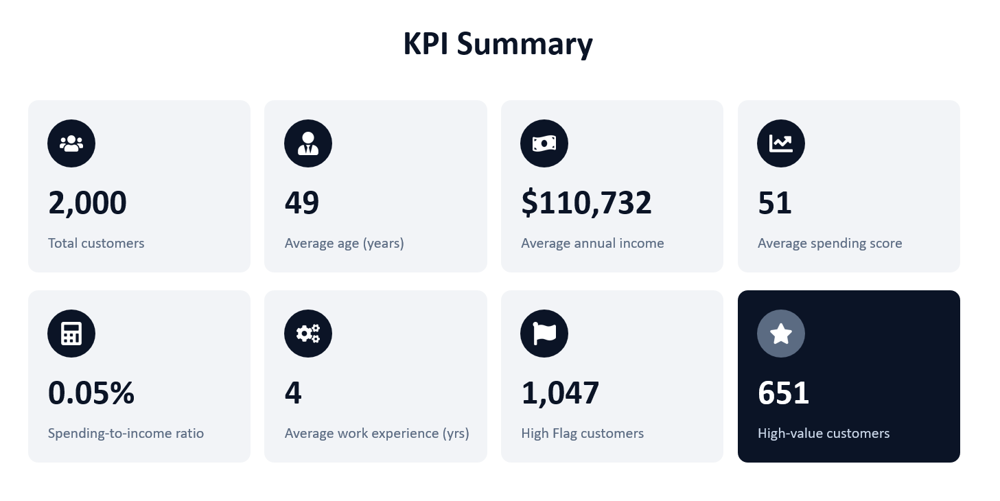
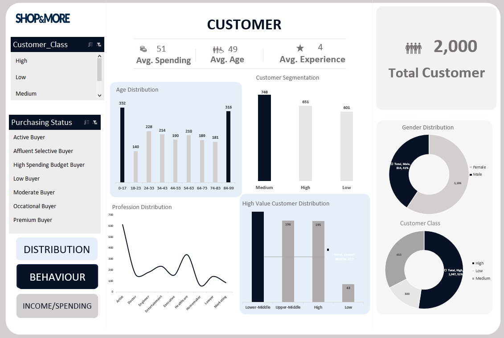
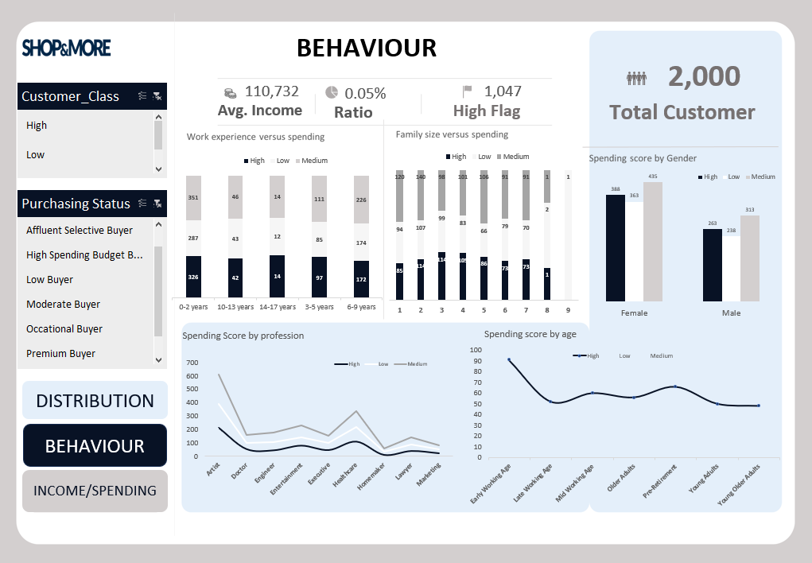
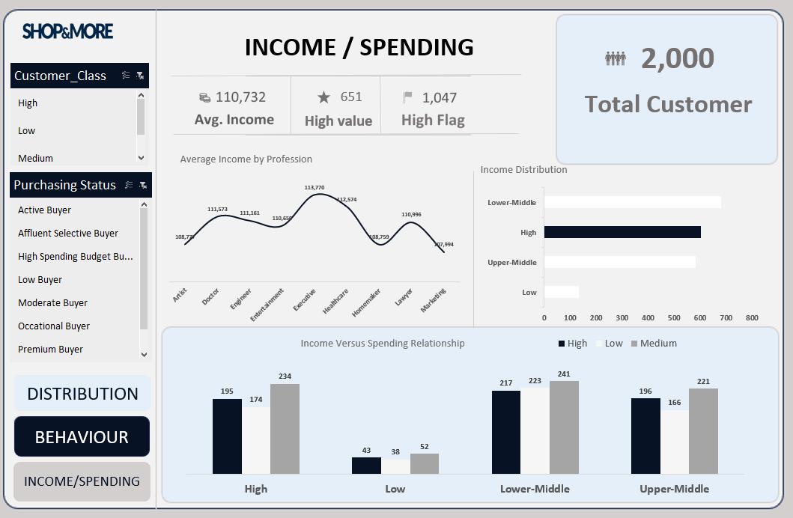
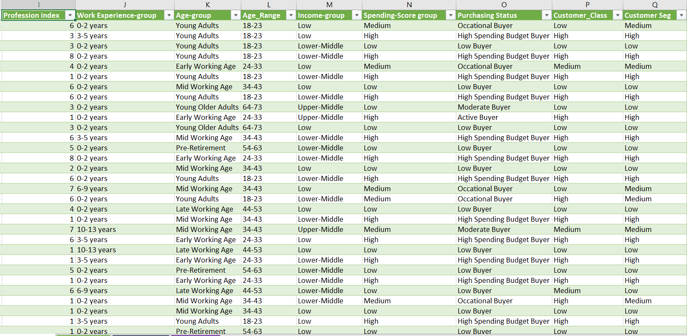
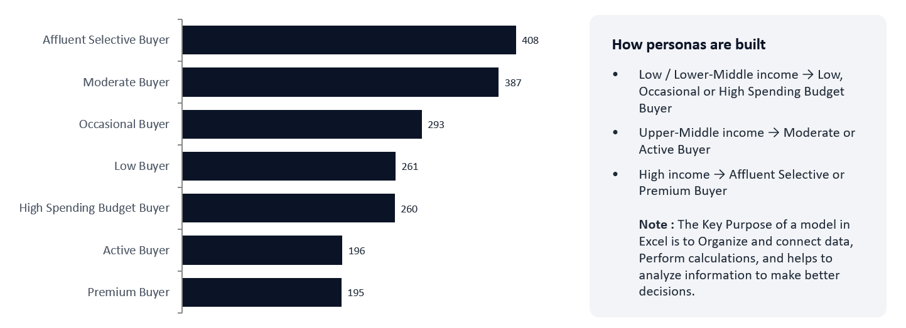

# Customer-Segmentation-Spending-Behaviour-Analysis


### An Excel-Based Retail Analytics Project Turning Customer Data into Actionable Marketing Insights


**Tools:** Microsoft Excel · Power Query · Power Pivot (DAX) · PivotTables · PivotCharts · Slicers · PowerPoint

**Dataset:** Shop Customer Data (Kaggle)  
**Records:** 2,000 Customers  
**Original Fields:** 8  
**Project Date:** October 2026

---

## Table of Contents

- [Project Overview](#-project-overview)
- [Business Questions](#-business-questions)
- [Key Performance Indicators](#-key-performance-indicators)
- [Dashboard Walkthrough](#-dashboard-walkthrough)
- [Data and Analytical Workflow](#-data-and-analytical-workflow)
- [Customer Segmentation](#-customer-segmentation)
- [Key Findings](#-key-findings)
- [Business Recommendations](#-business-recommendations)
- [Data Quality and Limitations](#-data-quality-interpretation-and-limitations)
- [Repository Structure](#-repository-structure)
- [Project Documentation](#-project-documentation-and-data-source)
- [About the Analyst](#-about-the-analyst)

---

##  Project Overview

Retail businesses need more than basic customer counts to plan marketing campaigns, identify high-spending customers, and tailor product offers.

This project analyses the demographics, annual income, and spending behaviour of **2,000 retail customers**, transforming raw customer data into actionable business insights through an interactive, three-page Excel dashboard.

The project involved:

- Cleaning and transforming customer data using **Power Query**.
- Developing customer segmentation features.
- Creating **8 DAX KPI measures** using Power Pivot.
- Building **15 PivotTable insight tables**.
- Designing interactive dashboards using PivotCharts and slicers.
- Presenting analytical findings through a structured reporting interface.

###  Headline Finding

Annual income and spending score have a Pearson correlation of approximately **0.02**, indicating almost no linear association in this dataset.

Interestingly, **217 of the 651 high-spending customers belong to the Lower-Middle income group**.

This suggests that income alone may not be a reliable indicator of customer spending behaviour.

---

##  Business Questions

The analysis was designed to answer the following business questions:

1. Which customer groups contribute the most high spenders?
2. How do age, gender, occupation, work experience, and family size relate to spending behaviour?
3. Does higher annual income correspond to a higher spending score?
4. Which customer personas should be prioritised for retention and targeted marketing campaigns?
5. How can decision-makers explore customer segments through an interactive dashboard?

---

##  Key Performance Indicators

| KPI | Result |
|---|---:|
| Total Customers | **2,000** |
| Average Age | **49 Years** |
| Average Annual Income | **$110,732** |
| Average Spending Score | **51 / 100** |
| Average Work Experience | **4 Years** |
| High-Value Customers (Score 67–100) | **651** |
| High-Class Customers (`Customer_Class = High`) | **1,047** |
| Reported Score-to-Income Ratio | **0.05%** |
| Income–Spending Score Correlation | **0.02** |



> **Metric clarification:** The 0.05% figure represents a ratio of an index score to an income amount. It is not a monetary spending-to-income ratio because actual customer expenditure was not supplied. Also, high-value customers (spending score ≥67) and high-class customers (`Customer_Class = High`) are two different classifications.

### KPI Summary


---

##  Dashboard Walkthrough

The project features three interactive dashboard pages, each designed to answer a different set of business questions.

### 1. Customer Distribution


This dashboard explores customer demographics and segmentation, including:

- Age distribution.
- Gender distribution.
- Customer profession.
- Spending-score groups.
- Customer classification.
- High-value customer distribution.



**Interactive features:** Slicers allow users to filter the dashboard by customer class and purchasing status.

### 2. Customer Behaviour


This dashboard examines spending behaviour across different customer characteristics.

It explores:

- Spending-score distribution by gender.
- Spending behaviour by profession.
- Age-group spending patterns.
- Work-experience distribution.
- Family-size comparisons.



The objective is to identify where higher-scoring customers are concentrated and understand how different customer characteristics relate to spending behaviour.

### 3. Income and Spending


This dashboard focuses on the relationship between annual income and customer spending.

It includes:

- Average annual income by profession.
- Distribution of customer income groups.
- Income-band comparisons.
- Cross-tabulation of income groups against spending-score groups.



This view helps decision-makers understand whether higher income necessarily translates into higher spending.

---

##  Data and Analytical Workflow

The project followed a structured data analytics workflow.

### Step 1: Data Inspection

Reviewed 2,000 customer records and eight original data fields:

| Field | Description |
|---|---|
| `CustomerID` | Unique customer identifier |
| `Gender` | Customer gender |
| `Age` | Customer age |
| `Annual Income ($)` | Customer annual income |
| `Spending Score (1-100)` | Store-defined customer spending index |
| `Profession` | Customer occupation |
| `Work Experience` | Years of professional experience |
| `Family Size` | Number of family members |

### Step 2: Data Preparation with Power Query

Performed data quality checks, including:

- Data type validation.
- Missing value inspection.
- Duplicate identification.
- Age and income range checks.
- Customer ID validation.

Key data quality observations:

- No duplicate CustomerIDs were identified.
- 332 customers were aged under 18, including 24 customers aged zero.
- Two customers had zero annual income.

These records were retained rather than removed.

### Step 3: Feature Engineering

Created nine calculated columns to support deeper analysis and segmentation.

These included:

- Age Bands.
- Income Bands.
- Spending Score Bands.
- Work Experience Bands.
- Purchasing Status.
- Customer Class.
- Customer Seg.



### Step 4: KPI Development Using DAX

Developed eight DAX measures in Power Pivot to calculate the headline business metrics.

### Step 5: Exploratory Data Analysis

Created 15 PivotTable insight tables covering:

- Customer demographics.
- Spending behaviour.
- Income distribution.
- Customer segmentation.
- Profession-based analysis.

### Step 6: Dashboard Development

Designed the dashboard layout in PowerPoint and integrated it into Excel.

The final dashboard includes:

- Interactive PivotCharts.
- Dynamic slicers.
- KPI summaries.
- Navigation buttons.
- Three analytical dashboard pages.

---

##  Customer Segmentation

Customers were grouped according to their spending scores and annual income.

### Spending Score Classification

| Spending Score | Classification |
|---|---|
| 0–33 | Low |
| 34–66 | Medium |
| 67–100 | High |

The analysis further developed seven purchasing personas by combining spending-score categories with income bands.

### Customer Personas

| Purchasing Persona | Customers | Customer Profile |
|---|---:|---|
| Affluent Selective Buyer | 408 | High income; low/medium spending |
| Moderate Buyer | 387 | Upper-Middle income; low/medium spending |
| Occasional Buyer | 293 | Low/Lower-Middle income; medium spending |
| Low Buyer | 261 | Low/Lower-Middle income; low spending |
| High Spending Budget Buyer | 260 | Low/Lower-Middle income; high spending |
| Active Buyer | 196 | Upper-Middle income; high spending |
| Premium Buyer | 195 | High income; high spending |
| **Total** | **2,000** | |



### Segmentation Insights

The segmentation reveals that customers with similar income levels can exhibit different spending behaviours.

For example:

- Affluent Selective Buyers represent the largest segment, with 408 customers.
- High Spending Budget Buyers demonstrate that high spending scores are not exclusive to high-income customers.
- Premium Buyers represent customers with both high income and high spending scores.

These distinctions provide opportunities for more targeted marketing strategies.

---

##  Key Findings

The analysis produced several important business insights.

### 1. Income Is a Weak Linear Predictor of Spending

The Pearson correlation between annual income and spending score is approximately `r = 0.02`.

This indicates almost no linear association between the two variables in this dataset.

However, this does not establish causation or rule out nonlinear relationships.

### 2. High Spenders Exist Across All Income Groups

The 651 high-spending customers are distributed across income groups as follows:

| Income Group | High-Spending Customers |
|---|---:|
| Low | 43 |
| Lower-Middle | 217 |
| Upper-Middle | 196 |
| High | 195 |
| **Total** | **651** |

The Lower-Middle income group contributes the largest number of high-spending customers.

### 3. High-Spending Customers Represent 32.6% of the Dataset

Out of 2,000 customers, 651 have spending scores between 67 and 100.

This represents approximately **32.6% of the customer population**.

### 4. Gender Distribution

| Gender | Customers | Percentage |
|---|---:|---:|
| Female | 1,186 | 59.3% |
| Male | 814 | 40.7% |
| **Total** | **2,000** | **100%** |

High-spender shares are similar within each gender, at approximately 32.7% and 32.3%, respectively.

### 5. Profession Distribution

The largest profession groups are:

- Artists: **612 customers**
- Healthcare Professionals: **339 customers**

These groups could provide opportunities for profession-based marketing experiments.

### 6. Age-Based Spending Behaviour

The 24–33 age band has the largest number of high spenders, with 91 customers among the adult age groups compared in the report.

### 7. Largest Customer Persona

Affluent Selective Buyers represent the largest purchasing persona, with 408 customers.

This segment presents an opportunity to test personalised premium offers and evaluate customer response.

For a deeper breakdown of the analysis and interpretations, see [Detailed Findings](docs/findings.md).

---

##  Business Recommendations

Based on the analysis, the following recommendations are proposed:

1. **Segment by observed behaviour:** Use actual spending-score patterns rather than relying on annual income alone when designing marketing campaigns.

2. **Prioritise customer retention:** Focus on the 651 high-spending-score customers, particularly the Premium and Active Buyer groups.

3. **Introduce value-focused bundles:** Test discounts, product bundles, and loyalty incentives for the 260 High Spending Budget Buyers.

4. **Test personalised premium offers:** Target the 408 Affluent Selective Buyers with carefully designed premium offers instead of assuming that high income automatically means higher spending.

5. **Explore profession-based campaigns:** Investigate targeted marketing opportunities among Artists, Healthcare Professionals, and Entertainment groups while monitoring campaign response rates.

6. **Improve data quality:** Review invalid age records and investigate missing or unrecorded profession values to improve future reporting accuracy.

---

##  Data Quality, Interpretation and Limitations

Several limitations should be considered when interpreting the findings.

- **Age quality:** The dataset contains 332 customers aged under 18, including 24 customers aged zero. These records remain in the headline KPIs, so the results should not be interpreted as representing a verified adult retail population.

- **Spending Score:** Spending Score is a store-defined index rather than an actual monetary expenditure value. The original dataset does not document its calculation methodology.

- **Customer Classification:** `Customer_Class` automatically assigns customers with annual incomes above $113,984 to the High category, irrespective of their spending score. Therefore, this classification is not interchangeable with high-spending status.

- **Correlation limitations:** A near-zero Pearson correlation indicates little linear association in this sample. It does not prove that income has no relationship with spending under every possible analytical model.

- **Project reproducibility:** This repository contains dashboard screenshots and the analytical report, but not the original Excel workbook or raw dataset. Interactive slicers can be explored in Excel, not directly through the GitHub screenshots.

---

## Repository Structure

```text
SHOP_AND_MORE_Retail_Analytics/
│
├── README.md
│
├── assets/
│   ├── kpi-summary.png
│   ├── customer-distribution.png
│   ├── customer-behaviour.png
│   └── income-spending.png
│
├── docs/
│   ├── findings.md
│   ├── data-dictionary.md
│   └── project-report.docx
│
└── .gitignore
